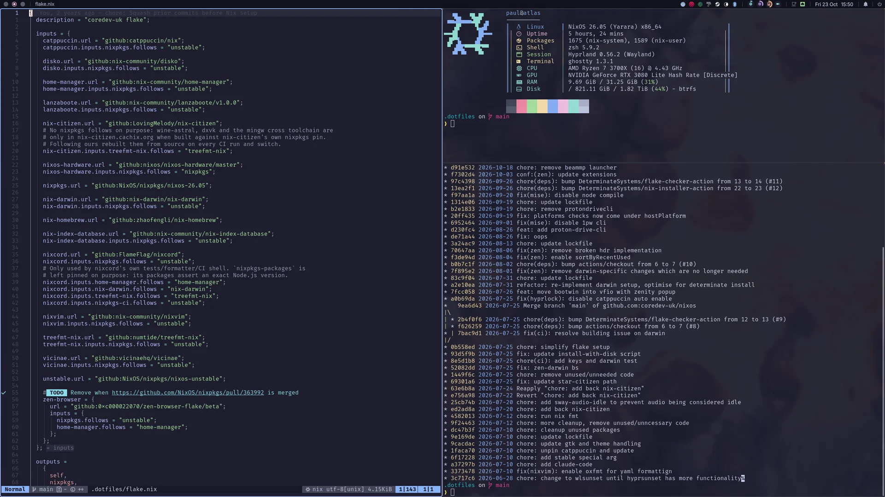

### NixOS Configuration

[](https://github.com/coredev-uk/nixos/actions/workflows/nix-check.yml)
[](https://github.com/coredev-uk/nixos/actions/workflows/hosts.yml)
[](https://github.com/coredev-uk/nixos/commits)

Core's Nix flake for NixOS and macOS: one configuration per machine, from disk layout to desktop.

[Hosts](#hosts) •
[Bootstrap](#bootstrap) •
[Write-up](https://coredev.uk/projects/nixos-configuration/) •
[Binary cache](https://github.com/coredev-uk/home-ops/blob/main/docs/nix-cache.md)

<br clear="left">



## Hosts

<details>
<summary>Machines this flake configures</summary>

|  Hostname  |         OS         | Device  |    WM    | Status  |
| :--------: | :----------------: | :-----: | :------: | :-----: |
|  `atlas`   |       NixOS        | Desktop | Hyprland | Working |
| `poseidon` | macOS (nix-darwin) | Laptop  |   N/A    | Working |
|  `athena`  | Windows + NixOS-WSL | Desktop |   N/A    | Working |

</details>

<details>
<summary>Where things live</summary>

| Path | Holds |
| :--- | :--- |
| `flake.nix`, `lib/` | Inputs, and the `mkHost`/`mkHome`/`mkDarwin` helpers every machine is built with |
| `hosts/<host>/` | One machine's system: `boot.nix`, `hardware.nix`, `extra.nix` |
| `hosts/common/` | System modules the hosts share (base, desktop, hardware, services, users) |
| `home/` | Home Manager: `common/shell` everywhere, `common/dev`, `common/desktop` and `common/programs` by host type |
| `overlays/default.nix` | Every patched or rebuilt nixpkgs package, each with why and when it can go |
| `pkgs/` | Packages nixpkgs doesn't have |

Nixpkgs fixes go in `overlays/default.nix`, never inline in a module.

</details>

## Bootstrap

Clone the repo, run `nix develop` then `./install-with-disk`.

<details>
<summary>Installing NixOS with Disko</summary>

Boot the NixOS installer, clone this repository, enter the dev shell, then run:

```sh
nix develop
./install-with-disk atlas
```

Destructive. For `atlas`, Disko wipes the WD_BLACK SN770 (by `/dev/disk/by-id/`, see
`hosts/atlas/disks.nix`) and creates GPT, an unencrypted `/boot` ESP, a LUKS container
`cryptroot` and btrfs subvolumes. Install Windows on the other NVMe first for dual boot. Expect
the LUKS passphrase prompt during install and at boot.

The installer runs Disko, installs the flake configuration, then copies this repository to
`/mnt/home/<user>/.dotfiles`.

Secure Boot uses Lanzaboote. The installer creates sbctl keys at `/mnt/var/lib/sbctl` before
`nixos-install`; firmware enrollment is manual. After the first boot, run:

```sh
sudo sbctl status
sudo sbctl enroll-keys --microsoft
sudo nixos-rebuild switch --flake ~/.dotfiles#atlas
sudo sbctl verify
```

Then reboot into firmware setup and enable Secure Boot. `--microsoft` keeps Microsoft keys (Windows
11 dual boot, firmware option ROMs). On ASUS boards set Secure Boot `OS Type` to `Windows UEFI Mode`;
without a setup-mode option, erase the Platform Key instead of clearing all keys. Old keys under
`/etc/secureboot` must be migrated first:

```sh
sudo sbctl setup --migrate
```

</details>

<details>
<summary>Setting up athena (Windows and NixOS-WSL)</summary>

athena is atlas's Windows install on the other drive: gaming first, plus Sona's Windows build
tools. Linux is `nixosConfigurations.athena` and `paul@athena` (NixOS-WSL). Windows config is in
`hosts/athena/windows`:

| File | What it describes |
| :--- | :--- |
| `gaming.winget`, `dev.winget` | Apps, registry settings and Sona's build tools (WinGet configurations) |
| `winutil.json` | The WinUtil debloat, run once with `-Debloat` |
| `default.nix` | The home files, rendered from the Linux modules (git, ssh and the shell from `paul@athena`; Wintty, Vicinae, VS Code, fonts) and laid out by Windows folder |
| `shell.nix`, `zen.nix` | PowerShell's profile from zsh's settings; atlas's Zen for Windows |
| `apply.ps1` | Builds the above in WSL and puts it all in place |

On a fresh stock Windows 11: sign in, install Proton Pass and enable its SSH agent (Settings → SSH
agent), and install the Wintty sponsor build from wintty.io. Then, from any Nix (another WSL
distro, or atlas), build the distribution and install it from an elevated PowerShell:

```sh
nix build .#nixosConfigurations.athena.config.system.build.tarballBuilder
sudo ./result/bin/nixos-wsl-tarball-builder   # writes nixos.wsl
```

```powershell
wsl --install --from-file nixos.wsl --name NixOS
wsl --set-default NixOS
```

In NixOS, clone this repository to `~/.dotfiles` and run `nh home switch`. Then apply Windows'
half, elevated, the first time with `-Debloat` (WinUtil's tweaks and app removals). `-GamingOnly`
leaves the development tools out; `-Test` shows what has drifted:

```powershell
powershell -ExecutionPolicy Bypass -File \\wsl.localhost\NixOS\home\paul\.dotfiles\hosts\athena\windows\apply.ps1 -Debloat
```

What winget can't install is listed at the top of `gaming.winget`. Zen gets atlas's setup
(`zen.nix`) once it has a profile: start it once, close it, apply again.

</details>

## Credits

Built on others' configurations, notably [jnsgruk/nixos-config](https://github.com/jnsgruk/nixos-config).

## Licence

Licensed under the MIT License ([LICENSE](LICENSE)).
